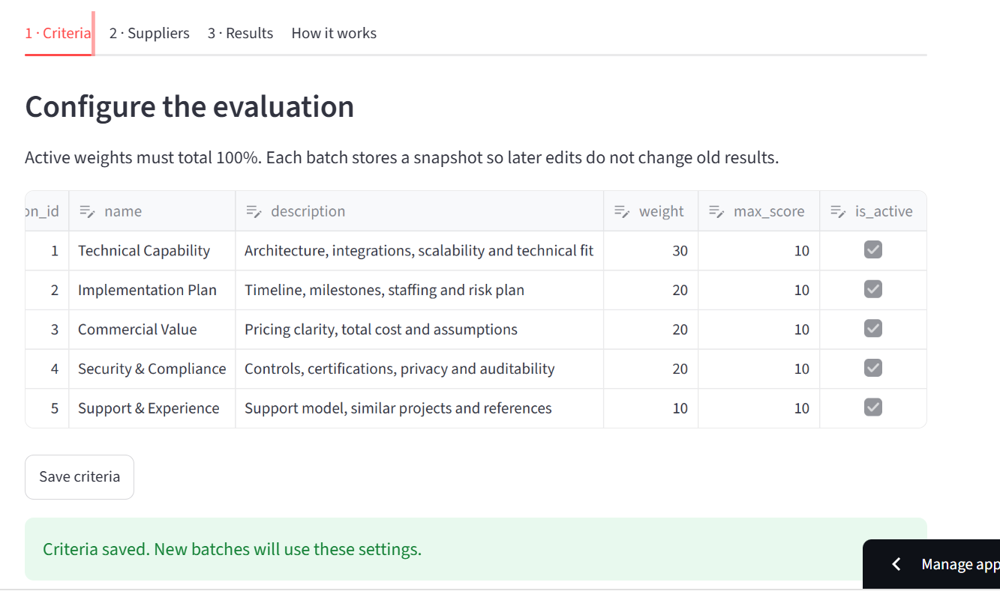
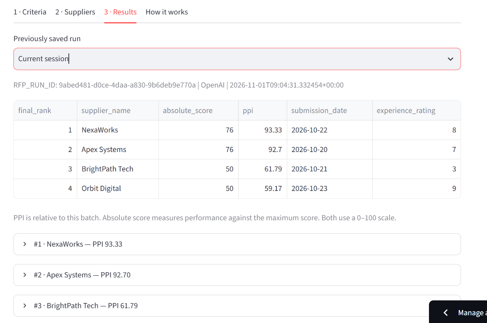
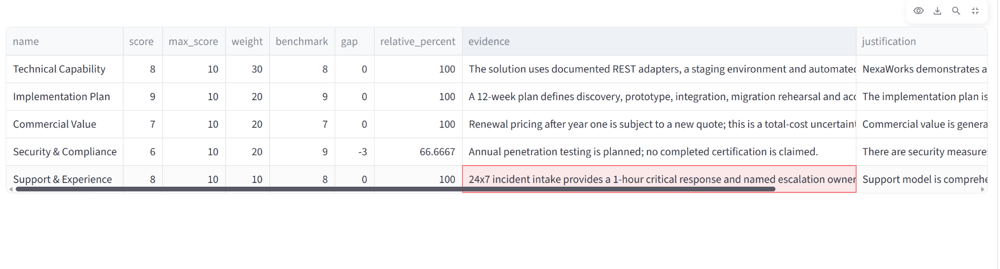
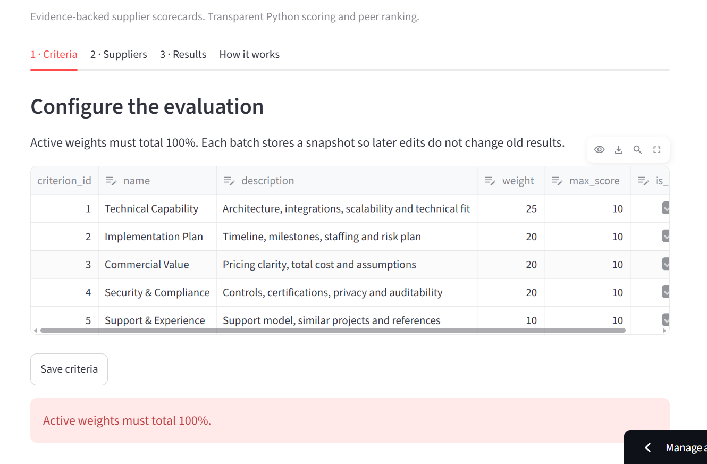

# Agentic RFP Evaluation and Supplier Ranking

A classroom application built from the supplied brief. Streamlit provides the interface, SQLite stores the rubric and completed runs, OpenAI evaluates document content, and Python owns every formula and rank. Demo mode uses disclosed, fixed synthetic scorecards and makes no model calls.

## 1. Run locally (Windows PowerShell)

Open a terminal in this folder. Python 3.11 or 3.12 is recommended.

```powershell
py -3.12 -m venv .venv
.\.venv\Scripts\python.exe -m pip install -r requirements.txt
.\.venv\Scripts\python.exe storage.py
.\.venv\Scripts\python.exe -m streamlit run app.py
```

Open the localhost address printed by Streamlit. The first launch seeds five criteria automatically; `storage.py` can also be run explicitly. No shell activation is required.

Start with **Demo**, leave **Use all four bundled sample proposals** checked, and click **Evaluate suppliers** in the Suppliers tab. Open Results to inspect the leaderboard and download JSON. The demo fixtures are matched by PDF SHA-256, so unrelated files cannot accidentally receive sample scores.

For real evaluation, select **OpenAI**, enter your API key in the password field and a JSON-capable model ID available to your account. The initial model field is a configurable example, `gpt-4o-mini`; availability is account-dependent. This path incurs API usage and sends extracted text to OpenAI. The key is not saved in SQLite or exports. Alternatively, copy `.streamlit/secrets.toml.example` to `.streamlit/secrets.toml` and set the key locally. Never commit that file.

## 2. What each building step teaches

1. **Define the rubric in a database (`storage.py`).** Criteria belong in data rather than hard-coded prompts. The five default weights are 30, 20, 20, 20 and 10. The Criteria tab can edit names, descriptions, weights, maxima and active status. Saving invalid totals is blocked.
2. **Extract document text (`workflow.extract_pdf`).** pypdf reads all pages with page labels. It rejects corrupted, encrypted, overly large or textless files. Scans need external OCR. Text is never silently truncated.
3. **Ask for evidence (`workflow.evaluate_openai`).** The dynamic prompt includes only the active rubric and one supplier's proposal. It asks for a JSON object with every criterion, score, justification, exact quote, risks and summary. The proposal is labelled untrusted input. The model cannot decide ranks.
4. **Normalize responses (`core.validate`).** Bad JSON and missing criteria become zero scores with warnings. Duplicate IDs keep the first occurrence; unknown IDs are ignored. Numeric strings are accepted, booleans/non-finite values are rejected, and scores are clipped to the database maximum. Database maxima override any model-provided maxima. An unmatched/missing quote forces a positive score to zero. Missing explanations are flagged. These are deliberately conservative classroom policies.
5. **Calculate scores (`core.rank`).** Arithmetic uses the validated scorecards only. Each criterion is compared with its strongest peer in the same batch.
6. **Persist an audit trail (`storage.save_run`).** A UUID identifies a run. One SQLite transaction stores all results with raw responses, extracted text, document hashes, rubric snapshot, warnings and ranking rules. An extraction/API failure aborts before persistence; partial results are not ranked or stored.
7. **Present the reasoning (`app.py`).** The leaderboard shows the outcome, while expandable scorecards show evidence, gaps, warnings and the reason for each placement. JSON contains the full precision values.

The orchestrator is explicit Python functions, as permitted by the brief. An agent framework is unnecessary for this fixed sequence of tools.

```text
Streamlit -> SQLite rubric snapshot -> PDF extraction -> OpenAI (or demo fixtures)
          -> validation -> weighted scores -> benchmarks/PPI -> stable sort
          -> atomic SQLite persistence -> leaderboard / evidence / JSON
```

## 3. Formulas and assumptions

Weights are percentages totalling 100 for active criteria.

| Metric | Formula |
|---|---|
| Absolute weighted score | Sum((score / configured maximum) * weight), out of 100 |
| Criterion benchmark | Highest normalized score for that criterion in this batch |
| Gap | Supplier score - benchmark |
| Relative performance | 100 * score / benchmark; 0 if benchmark is zero |
| Peer Performance Index | Sum(relative performance * weight / 100), out of 100 |

Example: score 8/10 with weight 30 contributes 24 absolute points. If the batch benchmark is 9, relative performance is 88.8889%, contributing 26.6667 PPI points.

Sort keys, in order: higher PPI; earlier ISO submission date; higher historical experience (0-10); case-insensitive alphabetical supplier name. PPI is rounded to 12 decimal places for equality in sorting to suppress floating-point noise, then sequential ranks 1, 2, 3... are assigned. Display values are rounded to two decimals only. Supplier names must be unique ignoring case. Absolute score is not a tie-break. A lone supplier with positive scores on every criterion has PPI 100 even if its absolute score is low; this is expected for a relative metric.

Demo scorecards are illustrative human-authored fixtures; changing the rubric can introduce missing/unknown criterion warnings. Use OpenAI to obtain scores for revised rubrics. Evidence matching normalizes case and whitespace; it establishes quote presence, not truthfulness, entailment, or scoring quality. LLM calls can vary between runs; replaying identical validated scorecards preserves the arithmetic and order.

## 4. Files and verification

| File | Purpose |
|---|---|
| `app.py` | Four-tab Streamlit interface |
| `core.py` | Validation, formulas, ranking and tie explanations |
| `workflow.py` | Document extraction, live OpenAI adapter and orchestration |
| `storage.py` | Schema, seed script, criteria updates and run persistence |
| `generate_samples.py` | Generates four three-page fictional proposals and matching fixtures |
| `samples/` | Bundled PDFs plus demo fixture JSON |
| `demo.py` | Reproducible successful batch and malformed JSON demonstration |
| `sample_run.json` | Complete exported demo run (not a live AI result) |
| `validation_example.json` | Error-case normalization output |
| `test_core.py` | Automated edge-case and integration tests |

```powershell
.\.venv\Scripts\python.exe -m unittest -v
.\.venv\Scripts\python.exe demo.py
```

The tests cover hand-calculated scores, zero benchmarks, every tie-break, malformed JSON, missing/duplicate/unknown IDs, invalid values, clipping, absent evidence, weight rejection, successful PDF-to-database replay and no partial save after API failure. Live API evaluation must be tested with your own key. Regenerating PDFs also regenerates their matching hashes; rerun `demo.py` afterward.

For a short demonstration: show active weights, run the four samples in Demo mode, inspect NexaWorks' scorecard, download JSON, and show `validation_example.json`. To demonstrate a UI error, change one active weight so the total is not 100 and press Save criteria; the app rejects the change. Then run OpenAI mode to demonstrate actual LLM evaluation.

## 5. Deploy to Streamlit Community Cloud

The application is deployed on Streamlit Community Cloud; the public link is provided below.

1. Create a GitHub repository containing this folder's source, requirements and samples. Exclude `.venv`, API keys and generated databases using `.gitignore`.
2. At Streamlit Community Cloud, create an app connected to that repository and set the entry file to `app.py` (or its repository-relative path).
3. In Advanced settings / Secrets, set `OPENAI_API_KEY = "your-key"`. Keep the repository free of secrets.
4. Deploy, run a four-supplier OpenAI evaluation, confirm scorecards and JSON export, and record the resulting public URL for submission.
5. Add screenshots of Criteria, Suppliers, Results and a detailed scorecard to your final submission. The local preview is not a public deployment.

SQLite on a hosted instance is a local classroom store, not durable shared production storage. Download important run JSON before restarts/redeployments. This demo has no login or per-user database isolation: a hosted visitor can see saved run history and edit criteria. Use only fictional data, and use per-session API keys or add authentication before sharing an owner-funded live API key publicly.

Official references: [OpenAI JSON outputs](https://developers.openai.com/api/docs/guides/structured-outputs?api-mode=chat), [Streamlit secrets](https://docs.streamlit.io/deploy/streamlit-community-cloud/deploy-your-app/secrets-management), [Streamlit deployment](https://docs.streamlit.io/deploy/streamlit-community-cloud/deploy-your-app/deploy).

## Live application

[Open the RFP Evaluation App](https://rfp-evaluator-p8dm7rylrr9mtmzhbpxsfa.streamlit.app/)

## Application screenshots

### Evaluation criteria


### OpenAI leaderboard


### Detailed supplier scorecard


### Validation error


## Completed OpenAI evaluation

A complete live AI evaluation result is available in
[Download the completed OpenAI run](<openai run output.json>)
